# MedGraph: project documentation

Theory (ER reduction, relational algebra, functional dependencies, normal forms, optimisation, concurrency, NoSQL)
is in [DESIGN_THEORY.md](DESIGN_THEORY.md). Syllabus and requirement coverage is in [SYLLABUS_MAP.md](SYLLABUS_MAP.md).

## 1. Problem statement
Hospital record systems find past cases with keyword search over relational tables. A doctor facing an unusual combination
of symptoms cannot find similar earlier cases unless the earlier notes used the same words: "becoming withdrawn and forgetful"
will not match "progressive memory loss and personality change".

## 2. Objectives
1. Keep structured hospital data consistent with constraints, triggers and transactions.
2. Store clinical notes as vector embeddings so past cases can be found by meaning.
3. Combine that vector search with ordinary relational filters and full-text search.
4. Give doctors and administrators a role-based web application over all of it.

## 3. Scope
**In scope:** patient registry, wards and admissions (admit, transfer, discharge), clinical notes with similar-case search,
prescriptions with stock control, medication stock, dashboard, audit log, authentication and two roles.
**Out of scope:** billing, appointments, imaging, integration with real hospital systems. All data is fictional.

## 4. Functional requirements
| ID | Requirement |
|---|---|
| FR1 | Sign in with email and password; sessions last 8 hours. |
| FR2 | Two roles. DOCTOR: patients, admissions, notes, similar-case search, prescriptions. ADMIN: patients, admissions (chooses the doctor), medication stock, audit log, deleting patients. |
| FR3 | Register, search, filter, edit patients; admins can delete a patient and all their records. |
| FR4 | Admit to a ward (refused when full), transfer between wards, discharge. |
| FR5 | Doctors write notes; each is embedded when saved; doctors can delete their own notes. |
| FR6 | Find similar cases by meaning, by keywords, or both; filter by age, gender, date and whether currently admitted; start from an existing note ("more like this"). |
| FR7 | Prescribe (stock reduced atomically, refused if insufficient); cancel (stock restored). |
| FR8 | Admin adds or restocks medications. |
| FR9 | Dashboard: counts, ward occupancy, admissions per day, doctor ranking, most prescribed, low stock, bed-count consistency check. |
| FR10 | Admin audit log, including which user made each change. |
| FR11 | Per-patient history combining admissions, discharges, notes and prescriptions. |

The three-level view of data: physical (tables, indexes, the HNSW graph), logical (the schema below), external
(views such as `v_active_admissions`, and the pages each role sees).

## 5. ER diagram
Chen notation (regenerate with `python scripts/er-diagram.py docs/er-diagram.svg`):

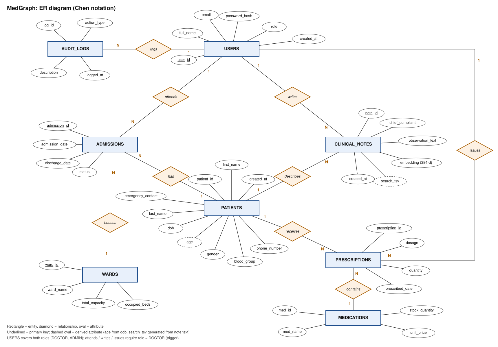

The same model in crow's-foot form, with every column:

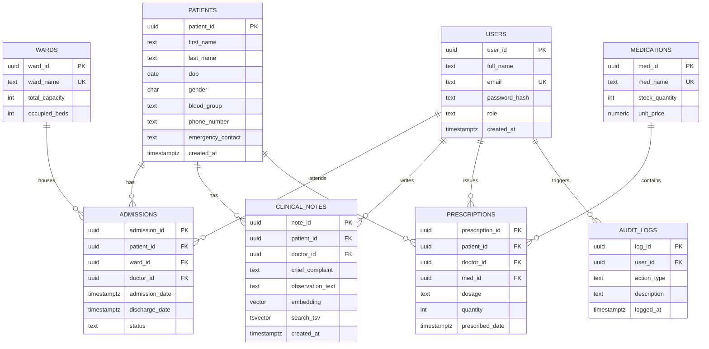
Cardinalities: a patient has many admissions, notes and prescriptions; a doctor (a USERS row with role DOCTOR) attends many admissions,
writes many notes and issues many prescriptions; a ward houses many admissions; a medication appears in many prescriptions; every user
action can produce many audit rows. `age` is derived from `dob`, and `search_tsv` is a generated column computed from the note text.

## 6. Relational schema
```
USERS(user_id PK, full_name, email UNIQUE, password_hash, role, created_at)
PATIENTS(patient_id PK, first_name, last_name, dob, gender, blood_group, phone_number, emergency_contact, created_at)
WARDS(ward_id PK, ward_name UNIQUE, total_capacity, occupied_beds)
ADMISSIONS(admission_id PK, patient_id FK->PATIENTS, ward_id FK->WARDS, doctor_id FK->USERS, admission_date, discharge_date, status)
CLINICAL_NOTES(note_id PK, patient_id FK->PATIENTS, doctor_id FK->USERS, chief_complaint, observation_text, embedding, search_tsv, created_at)
MEDICATIONS(med_id PK, med_name UNIQUE, stock_quantity, unit_price)
PRESCRIPTIONS(prescription_id PK, patient_id FK->PATIENTS, doctor_id FK->USERS, med_id FK->MEDICATIONS, dosage, quantity, prescribed_date)
AUDIT_LOGS(log_id PK, user_id FK->USERS, action_type, description, logged_at)
```
Delete rules: patient to admissions, notes and prescriptions `CASCADE`; doctor, ward and audit user `SET NULL`; medication to prescriptions `RESTRICT`.

## 7. Database choice and justification
| Data | Store | Reason |
|---|---|---|
| Users, patients, wards, admissions, medications, prescriptions, audit | PostgreSQL tables | Fixed structure, many relationships, needs constraints, joins, transactions and triggers |
| Clinical note embeddings | PostgreSQL `vector(384)` column (pgvector) | Meaning-based retrieval needs nearest-neighbour search over vectors |

**Why pgvector rather than a separate vector database (Qdrant, Chroma).** The vector sits in the same row as the note, so one SQL statement can
combine similarity with filters on patients, and the note is deleted with its patient by the same cascade. A separate store would need an ID
reference (the Lab 4 draft used `vector_id`) and a job to keep the two stores in step. One database is also one thing to secure and back up.
**Why PostgreSQL rather than MySQL.** pgvector, generated `tsvector` columns with GIN indexes, partial unique indexes and enforced CHECK constraints.
**NoSQL** (document, key-value, graph) was considered and rejected; see DESIGN_THEORY.md section 6.

## 8. Semantic search
| Question | Answer |
|---|---|
| What is embedded? | `chief_complaint + ". " + observation_text` of each note, and the doctor's query text |
| Model | `all-MiniLM-L6-v2` (sentence-transformers), 384 dimensions, mean pooling, L2-normalised; runs locally through `@huggingface/transformers`, no external API |
| Storage | `clinical_notes.embedding vector(384)` with an HNSW index (`vector_cosine_ops`) |
| Similarity metric | Cosine: `1 - (a <=> b)`. Vectors are normalised, so cosine, dot product and Euclidean rank identically |
| Retrieval | Embed the query, then `ORDER BY embedding <=> query LIMIT k` joined to patients, with optional filters in the same `WHERE` |
| Other modes | Keyword (full-text, `websearch_to_tsquery`, `ts_rank`, `ts_headline`); Hybrid (both ranked lists merged by Reciprocal Rank Fusion, score = 1/(60+rank) summed); "More like this" (uses a stored vector, no model call) |
| Metadata kept with each vector | patient, doctor, timestamp, in the same row |
| Limitation | The model is general-purpose, not trained on medical text; similarity scores are for ranking, not diagnosis |

## 9. Data dictionary
Constraint names are the ones in `sql/01_schema.sql`; the app turns them into messages.

| Table | Column | Type | Rules |
|---|---|---|---|
| users | user_id | UUID | PK, generated |
| | full_name | varchar(100) | not blank (`chk_users_name`) |
| | email | varchar(100) | unique (`uq_users_email`), email format (`chk_users_email`) |
| | password_hash | varchar(255) | bcrypt hash |
| | role | varchar(10) | `DOCTOR` or `ADMIN` (`chk_users_role`) |
| patients | patient_id | UUID | PK |
| | first_name, last_name | varchar(50) | not blank |
| | dob | date | after 1900 (`chk_patients_dob`) |
| | gender | char(1) | M, F, O |
| | blood_group | varchar(3) | one of 8 values |
| | phone_number, emergency_contact | varchar(20) | 7 to 20 characters of digits, space, + or - |
| wards | ward_id | UUID | PK |
| | ward_name | varchar(50) | unique |
| | total_capacity | int | > 0 |
| | occupied_beds | int | >= 0 and <= total_capacity; maintained by trigger |
| medications | med_id | UUID | PK |
| | med_name | varchar(100) | unique |
| | stock_quantity | int | >= 0 |
| | unit_price | numeric(10,2) | > 0 |
| admissions | admission_id | UUID | PK |
| | patient_id | UUID | FK, cascade; one `ADMITTED` row per patient (partial unique index) |
| | ward_id, doctor_id | UUID | FK, set null; doctor must be a DOCTOR (trigger) |
| | admission_date, discharge_date | timestamptz | discharge not before admission; null exactly while ADMITTED |
| | status | varchar(10) | ADMITTED or DISCHARGED |
| clinical_notes | note_id | UUID | PK |
| | patient_id, doctor_id | UUID | FK (cascade, set null); doctor must be a DOCTOR |
| | chief_complaint, observation_text | text | not blank |
| | embedding | vector(384) | HNSW index |
| | search_tsv | tsvector | generated from the two text columns (A and B weights), GIN index |
| prescriptions | prescription_id | UUID | PK |
| | patient_id, doctor_id, med_id | UUID | FK (cascade, set null, restrict) |
| | dosage | varchar(50) | not blank |
| | quantity | int | 1 to 1000 |
| audit_logs | log_id | UUID | PK |
| | user_id | UUID | FK, set null |
| | action_type, description | varchar(50), text | |
| | logged_at | timestamptz | `clock_timestamp()` so rows in one transaction keep their order |

## 10. Database implementation and important queries
See [SYLLABUS_MAP.md](SYLLABUS_MAP.md) for a file-by-file index. The SQL files run in this order:
`01_schema`, `02_indexes`, `03_functions_triggers`, `04_views`, `05_alter_drop_demo` (applied by `npm run db:setup`),
then `06_queries`, `07_dml_examples` (rolled back), `08_transaction_demo` (manual, two sessions), `09_explain`.

Business-rule errors use their own SQLSTATE codes so the application can tell them from ordinary constraint errors:
`MG001` ward full, `MG002` not a doctor, `MG003` not found, `MG004` not enough stock, `MG005` invalid request.
The application tells the database who is acting with `set_config('app.user_id', ..., true)` at the start of each write transaction,
so the audit triggers record the real user, even for rows removed by a cascade.

## 11. System architecture
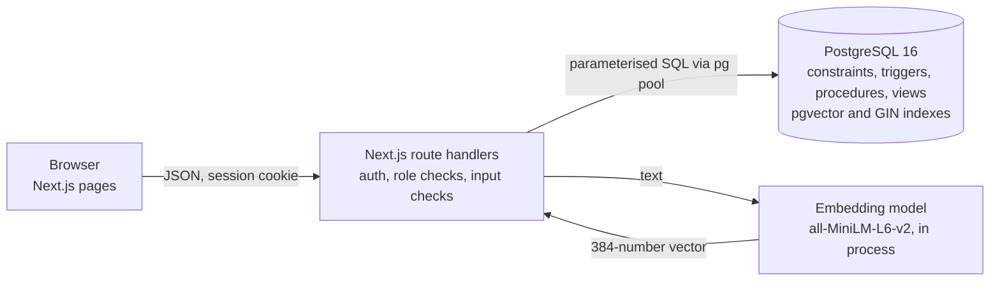
Security: bcrypt password hashes; JWT in an httpOnly, SameSite cookie (Secure in production); middleware and every route check the role;
parameterised queries only; secrets in environment variables; unknown emails take the same time as wrong passwords; failed sign-ins are logged.
The application does not rate-limit sign-in attempts (listed under future work).

## 12. Application screenshots
Taken from the running app with the seeded demo data (`docs/screenshots/`).

**1. Sign-in page**

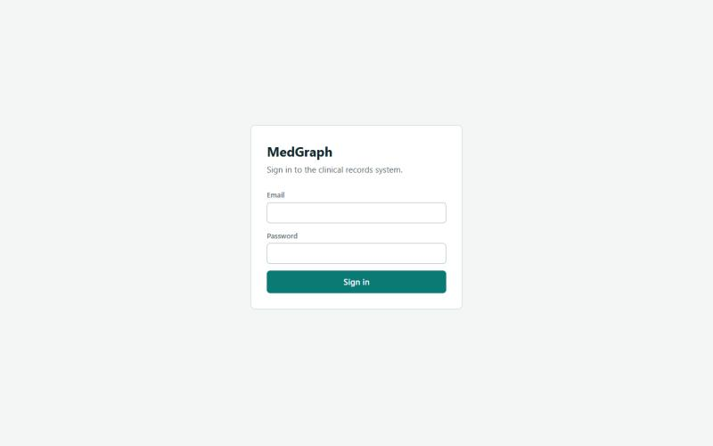

**2. Dashboard (doctor): counts, ward occupancy from v_ward_occupancy, 7-day admissions from a recursive CTE, doctor workload ranked with RANK()**

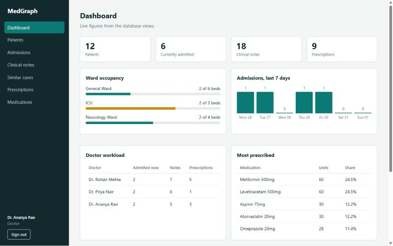

**3. Patients list with name search and blood-group filter**

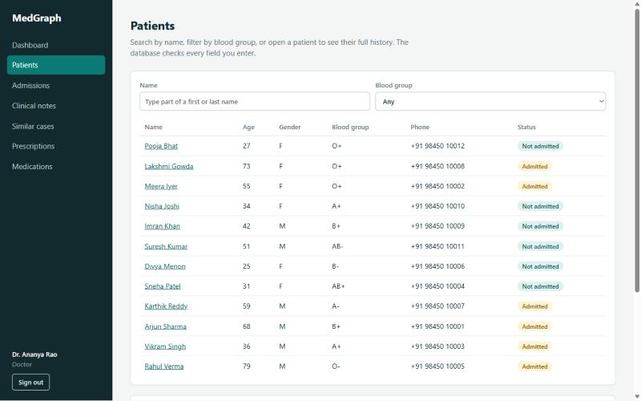

**4. Patient history from the v_patient_timeline view (UNION ALL of admissions and notes)**

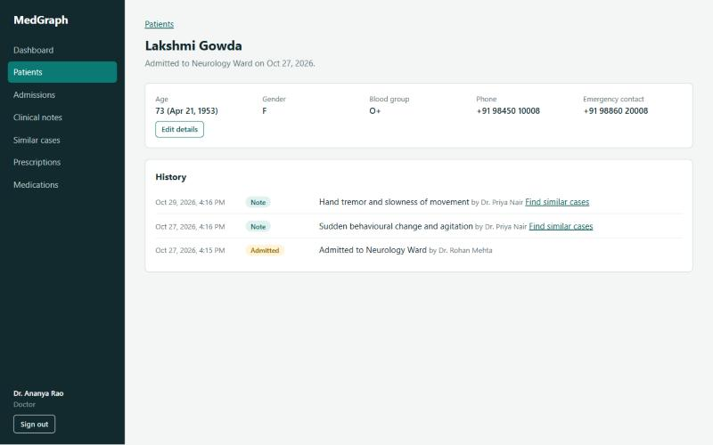

**5. Admissions: the last ICU bed has been taken, and admit_patient() refuses the next admission with "That ward is full" (MG001)**

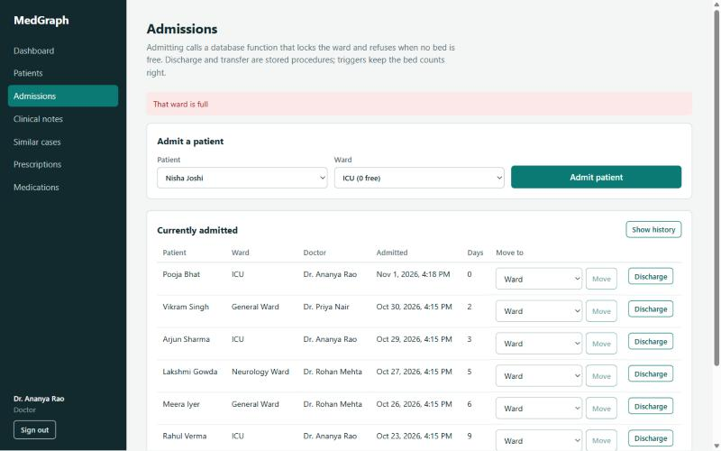

**6. Clinical notes: saving a note stores its 384-dimension embedding**

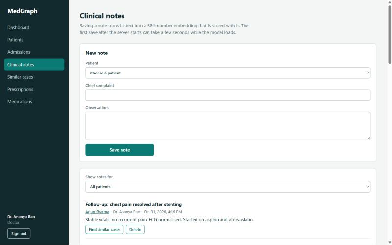

**7. Similar cases, Meaning mode, with an "Age from 60" filter**

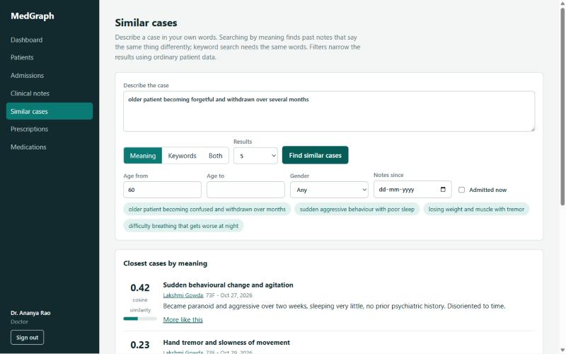

**8. Meaning results ranked by cosine similarity: the paraphrase finds the behavioural-change note even though no words match**

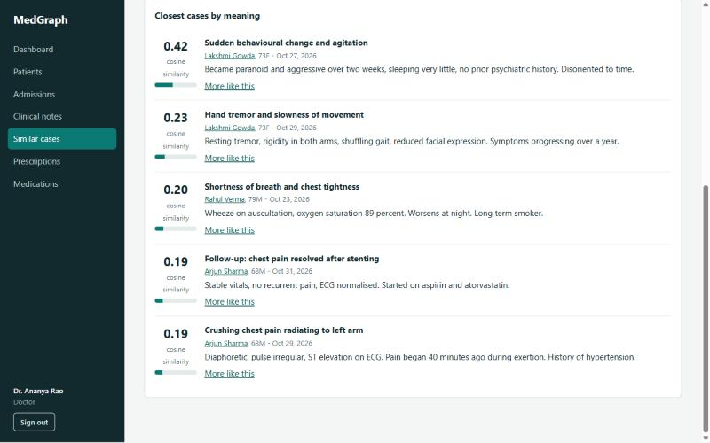

**9. The same query in Keywords mode finds nothing, because full-text search needs the words to appear**

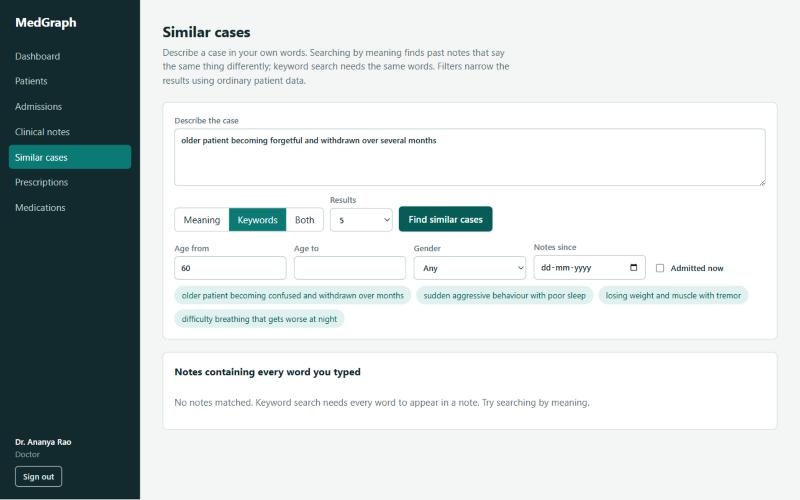

**10. Both mode: vector and full-text ranks combined with reciprocal rank fusion**

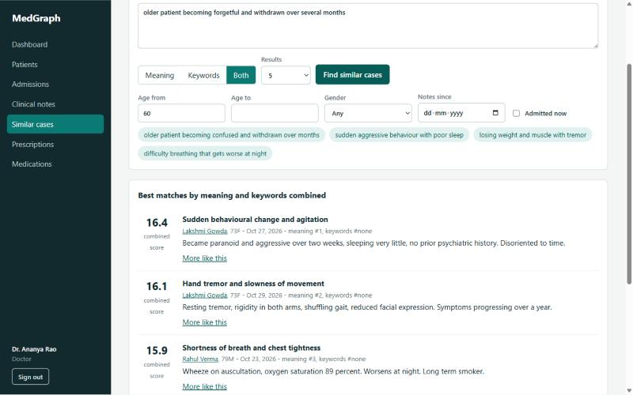

**11. Prescriptions: asking for 60 insulin pens with 42 in stock is refused by the stock trigger ("Only 42 units in stock", MG004)**

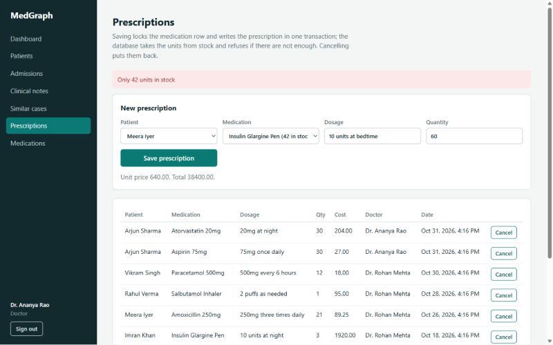

**12. Medications as admin (low stock highlighted)**

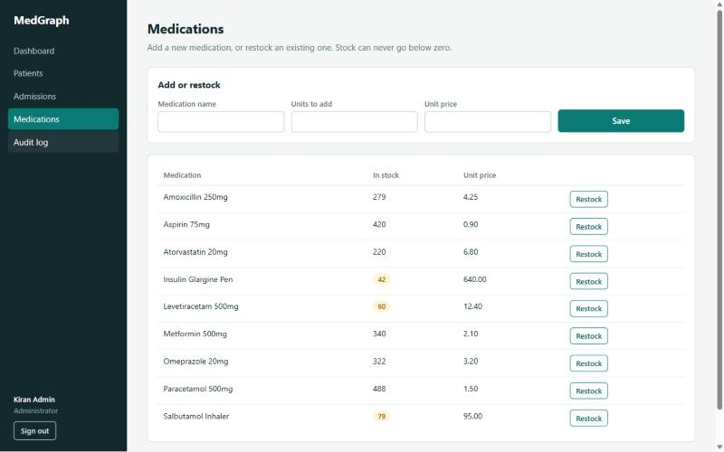

**13. Audit log as admin: sign-ins and searches from the app, inserts written by triggers with the acting user**

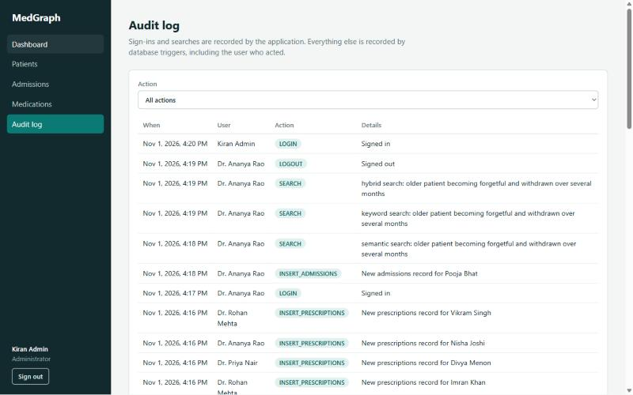

## 13. Testing results
`npm run test:db` runs 27 tests (29 with `-- --model`); every test is rolled back. Output of `npm run test:db -- --model` (also saved in `docs/results/`):

```
T01  PASS  Occupied beds cannot exceed ward capacity
T02  PASS  Invalid blood group is rejected
T03  PASS  Malformed phone number is rejected
T04  PASS  Negative stock and zero price are rejected
T05  PASS  Duplicate email and invalid role are rejected
T06  PASS  Foreign key blocks a note for an unknown patient
T07  PASS  Discharge cannot precede admission; status must match dates
T08  PASS  Prescription quantity limit added later with ALTER TABLE
T09  PASS  Only DOCTOR accounts can be the responsible doctor
T10  PASS  Admit and discharge keep occupied_beds in step
T11  PASS  Admitting into a full ward fails with MG001
T12  PASS  A patient cannot have two active admissions
T13  PASS  transfer_patient moves the bed count from one ward to the other
T14  PASS  transfer_patient into a full ward fails and changes nothing
T15  PASS  Prescribing reduces stock; too large a quantity fails with MG004
T16  PASS  Deleting a prescription gives the stock back
T17  PASS  Audit rows record the acting user (app.user_id) for update and delete
T18  PASS  Deleting a patient cascades to notes, admissions and prescriptions
T19  PASS  Inserting a clinical note writes an audit row
T20  PASS  All views return rows and stored bed counts match reality
T21  PASS  B-tree, partial, GIN and HNSW indexes exist
T22  PASS  Full-text search with stemming and ranking
T23  PASS  Passwords are bcrypt hashes
T24  PASS  Every note has a 384-dimension embedding
T25  PASS  Every statement in sql/06_queries.sql runs
T26  PASS  Every statement in sql/07_dml_examples.sql runs
T27  PASS  Every statement in sql/09_explain.sql runs
T28  PASS  Semantic search ranks the memory-loss note first for a paraphrase
T29  PASS  Semantic search finds a note that keyword search misses

29/29 passed
```

| Tests | What they prove |
|---|---|
| T01 to T08 | Constraints reject bad data: bed overflow, blood group, phone, stock, price, duplicate email, role, foreign key, dates, quantity limit |
| T09 | Only doctors can be the responsible doctor |
| T10 to T14 | Bed counts follow admit, discharge and transfer; full wards are refused; failed transfer changes nothing |
| T15, T16 | Prescribing takes stock and refuses overdraw; cancelling restores it |
| T17 to T19 | Audit rows name the acting user; deleting a patient cascades and the triggers free the bed and return stock |
| T20 to T24 | Views work and bed counts are consistent; all index types exist; full-text stemming; bcrypt hashes; every note has 384 dimensions |
| T25 to T27 | Every statement in `06_queries.sql`, `07_dml_examples.sql` and `09_explain.sql` runs |
| T28, T29 (`--model`) | A paraphrase finds the memory-loss note; the same query finds nothing by keyword |

Output of `npm run demo:concurrency`:

```
=== 1. Lost update: two doctors each take 3 units from a stock of 10 (expected result: 4)
  without locking:    stock = 7   <- one update was lost
  SELECT ... FOR UPDATE: stock = 4   <- second transaction waited for the first

=== 2. The last bed: two admissions race for a ward with capacity 1 (admit_patient locks the ward row)
  session A: admitted
  session B: refused (MG001) That ward is full
  beds used: 1 of 1

=== 3. Deadlock: two transactions lock the same two wards in opposite order
  session A: aborted by PostgreSQL (40P01): deadlock detected
  session B: committed

=== 4. Same two locks, but both sessions lock in ward_id order (what transfer_patient does)
  session A: committed
  session B: committed (after waiting for A)

=== 5. Isolation levels: B changes the stock and commits while A is still inside a transaction
  READ COMMITTED  A reads 10, then 9   (non-repeatable read: A sees B's commit)
  REPEATABLE READ A reads 10, then 10   (repeatable: A sees its snapshot)
                  A then updates the row B changed: 40001 could not serialize access due to concurrent update  -> roll back and retry

Done. Temporary rows are being removed.
```

Output of `npm run demo:explain` (50,000 generated patients and 5,000 generated notes, all rolled back):

```
Generating 50,000 patients ...

B-tree expression index on lower(last_name), about 10 matching rows out of 50,000:
  index disabled (forced seq scan)   Seq Scan on patients                                           Execution Time: 9.021 ms
  index available                    Bitmap Heap Scan on patients                                   Execution Time: 0.040 ms

Partial index (only ADMITTED rows) is tiny compared with the whole admissions table:
  partial index 16 kB   vs   full index on a different column 16 kB

Generating 5,000 notes with random 384-dimension vectors ...

Nearest 5 notes by cosine distance:
  exact: scan every row and sort     ->  Seq Scan on clinical_notes                                 Execution Time: 2.340 ms
  approximate: HNSW index            ->  Index Scan using idx_notes_embedding_hnsw on clinical_notes Execution Time: 1.221 ms
  (HNSW trades a little accuracy for speed; random vectors are the worst case for it.)

Rolled back: no data was kept.
```

Manual application tests to record in the demo: wrong password; a doctor cannot open `/audit` (redirected) or call `/api/audit` (403); an admin cannot call `/api/search` (403);
admitting past capacity shows "That ward is full"; prescribing more than the stock shows "Only N units in stock"; deleting a patient as admin removes their notes.

Results from the running app:

| Manual test | Result |
|---|---|
| Wrong password | `POST /api/auth/login` returns 401 "Incorrect email or password." |
| Doctor opens `/audit` | Redirected by the middleware |
| Doctor calls `/api/audit` | 403 |
| Admin calls `/api/search` | 403 |
| Admit into a full ward | "That ward is full" (screenshot 5) |
| Prescribe more than the stock | "Only 42 units in stock" (screenshot 11) |
| Admin deletes a patient | Not done in the UI so the demo data stays intact; the cascade is covered by test T18 |

## 14. Conclusion and future enhancements
MedGraph keeps structured hospital data consistent inside PostgreSQL and lets doctors retrieve clinically similar past cases by meaning, in the same
database and the same transaction. Future work: a medical-domain embedding model; row-level security so doctors see only their patients; rate limiting
and lockout on sign-in; de-identifying notes before embedding; allergies and conditions as separate tables (4NF); a graph view of patients linked by doctors, wards and similar notes;
pagination for long lists; automated browser tests.

## 15. Team contributions
Work was split evenly by file; the Git history shows who committed each one.

| Area | Vishal (PES1UG24AM241) | Samarth A (PES1UG24AM243) |
|---|---|---|
| ER diagram and schema | Tables, keys and constraints (`sql/01_schema.sql`); relational schema (section 6) | Chen diagram (`docs/er-diagram.svg`, `scripts/er-diagram.py`); indexes (`sql/02_indexes.sql`) |
| Functions, procedures, triggers, views | `sql/03_functions_triggers.sql` (`admit_patient`, `discharge_patient`, `transfer_patient`, bed-count, stock and audit triggers); `sql/05_alter_drop_demo.sql` | Views (`sql/04_views.sql`); DML, transaction and EXPLAIN scripts (`sql/07` to `sql/09`) |
| Queries | `sql/06_queries.sql` (queries by syllabus unit) | Full-text and vector search query builder (`lib/search.js`) |
| Embeddings and similar-case search | | Embedding pipeline (`lib/embed.mjs`), search API and page (Meaning, Keywords, Both) |
| Auth and API routes | Login and logout, JWT and bcrypt (`lib/auth.js`), `middleware.js`; patients, admissions, wards and doctors routes | Database pool and transactions (`lib/db.js`), error mapping; notes, prescriptions, medications, search, dashboard and audit routes |
| UI pages | Login, dashboard, patients, patient history, admissions | Layout and shell, notes, similar cases, prescriptions, medications, audit log |
| Scripts and testing | Database tests (`scripts/test-db.mjs`), concurrency demo | Setup, seed and EXPLAIN demo scripts; test and demo results; screenshots |
| Documentation | `DESIGN_THEORY.md` (ER reduction, relational algebra, normalisation), `DEMO_SCRIPT.md` | `README.md`, `DOCUMENTATION.md`, `SYLLABUS_MAP.md` |
